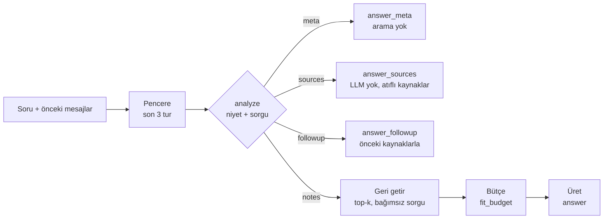

# Kişisel Not Arama

Türkçe kişisel notların üzerinde çalışan, **framework kullanmadan** (LangChain yok) yazılmış, tamamen yerel bir RAG (Retrieval-Augmented Generation) projesi. Notlarına soru sorarsın; cevap yalnızca notlarındaki bilgiye dayanır ve kaynak parçalar gösterilir. Veri makineden dışarı çıkmaz.

Proje aynı zamanda bir **öğrenme projesidir**: RAG'in her adımı (yükleme, parçalama, embedding, indeks, arama, üretim, yönlendirme, sorgu yeniden yazma, konuşma hafızası) küçük ve okunabilir bir dosyada durur.

`data/notes/` altındaki notlar **örnek** notlardır; kendi klasörünü seçebilirsin.

## Özellikler

- **Masaüstü uygulaması (PySide6):** kenar çubuğu (not listesi, not ekleme, klasör seçme, yeniden indeksleme), ayarlar penceresi (top_k, indeks yöntemi), sohbet geçmişi (yeni / aç / yeniden adlandır / sil), açılır kaynak listesi, "Aranan: ..." satırı, yazıyor animasyonu. Ağır işler arka planda çalışır, arayüz donmaz.
- **Streamlit arayüzü:** aynı hat, tarayıcıda.
- **Komut satırı:** `index`, `ask` (tek soru), `chat` (çok turlu sohbet).
- **Konuşma hafızası:** "peki teslim tarihi?" gibi takip soruları önceki konuşma bağlamıyla anlaşılır.
- **Yönlendirme:** selamlaşma / asistan soruları aramaya gitmez; "doğru mu?" gibi sorular önceki cevabın kaynaklarıyla kontrol edilir.
- **Çıktı kalitesi:** kaynak atfı (`[1]`), "bilmiyorum" davranışı, PDF'lerde sayfa numarası.

### Desteklenen biçimler

| Biçim | Not |
|---|---|
| `.md`, `.txt` | UTF-8; `#` başlıkları kaynak gösteriminde kullanılır |
| `.pdf` | sayfa numarasıyla kaynak gösterilir; taranmış (metinsiz) PDF için OCR yok, atlanır |
| `.docx` | başlıklar ve tablolar |
| `.html` | metin çıkarılır |

Alt klasörler dahil taranır; okunamayan dosyalar uyarıyla atlanır.

## Kurulum

Gereksinimler: Python 3.12, [uv](https://docs.astral.sh/uv/), [Ollama](https://ollama.com).

```bash
uv sync                      # bağımlılıklar (CUDA torch 2.15 / cu132 wheel ~3 GB, sentence-transformers, chromadb, PySide6...)
ollama pull qwen3.5:4b       # üretim (LLM) modeli
```

GPU: `pyproject.toml` torch'u CUDA 13.2 (`cu132`) wheel'inden alır (~3 GB indirme; CUDA 13.2 destekleyen NVIDIA sürücüsü gerekir). NVIDIA GPU'nuz yoksa indirme boyutunu küçültmek için `[[tool.uv.index]]` adresini `https://download.pytorch.org/whl/cpu` yapıp `uv lock` çalıştırın; uygulama CUDA yoksa kendiliğinden CPU'ya düşer.

- **Embedding:** `BAAI/bge-m3`. **İndeksleme GPU'da fp16** (CUDA yoksa/VRAM yetmezse CPU'ya düşer; indeksleme öncesi Ollama LLM'i boşaltılır, model sonra VRAM'den çıkarılır). **Soru embedding'i CPU'da** (`EMBED_DEVICE_QUERY = "cpu"`). Ölçüm: soruları da GPU'ya almak RAM'i yalnız ~0.3 GB azalttı (CUDA kütüphaneleri RAM'de yer kaplıyor), açılışta ~4 GB anlık zirve ve +1.2 GB VRAM getirdi; bu yüzden varsayılan CPU. Tek model paylaşımlı GPU modu için `EMBED_DEVICE_QUERY = "auto"`. İlk kullanımda Hugging Face'ten otomatik iner (`~/.cache/huggingface`). Elle bir şey yapman gerekmez.
- **LLM:** `qwen3.5:4b`, Ollama üzerinden (GPU varsa kullanır).

Ollama servisi için önerilen ortam değişkenleri (VRAM'i verimli kullanır; `systemctl edit ollama` ile veya servisi başlatırken):

```bash
OLLAMA_FLASH_ATTENTION=1
OLLAMA_KV_CACHE_TYPE=q8_0
OLLAMA_MAX_LOADED_MODELS=1
```

Servis çalışmıyorsa: `ollama serve`.

## Kullanım

```bash
uv run python -m desktop.main                       # masaüstü uygulaması
uv run streamlit run app.py                         # Streamlit arayüzü (repo kökünden çalıştır: .streamlit/config.toml yalnız localhost dinler)

uv run python -m src.cli index                      # notları oku, parçala, embed et, indeksle
uv run python -m src.cli ask "Proje Nova bütçesi nedir?"   # tek soru, hafızasız
uv run python -m src.cli chat                       # çok turlu sohbet (geçmiş bellekte, kaydedilmez)
uv run python -m src.cli ask "Soru?" --backend numpy       # varsayılan chroma; numpy elle kosinüs
uv run python -m src.cli ask "Soru?" --notes-dir /yol/notlarim   # tek seferlik klasör (ayarı değiştirmez)
uv run python -m src.cli set-notes-dir /yol/notlarim       # kalıcı not klasörü

uv run python -m eval.run_eval                      # model + chunk boyutu karşılaştırması -> eval/results.md
uv run python -m eval.run_followup_eval             # takip sorusu değerlendirmesi -> eval/followup_results.md
```

`chat` komutunda çıkmak için boş satır, `q` veya Ctrl-D kullan. Notları ekledikten/değiştirdikten sonra `index`'i (veya arayüzde "Yeniden indeksle") çalıştır.

### Uygulama menüsüne kurma (Linux)

```bash
bash scripts/install_desktop_entry.sh     # kısayol + ikon ekler (yol kurulum anında hesaplanır)
bash scripts/uninstall_desktop_entry.sh   # kısayolu ve ikonu kaldırır
```

## RAG hattı

Her soru şu adımlardan geçer (`desktop/services.py` içindeki `ask`, aynı hat Streamlit ve CLI `chat` içinde de var):



Geçmiş yoksa `analyze` yalnızca kural yolunu kullanır (LLM çağrısı yok); geçmiş varsa kural ön-kontrollerinden sonra tek bir LLM çağrısı hem niyeti hem bağımsız arama sorgusunu üretir. Hata olursa kural yoluna düşer.

| Niyet | Ne zaman | Ne olur |
|---|---|---|
| `notes` | Notlarda yeni arama gerekir ("peki teslim tarihi?", "başka hangi raporda geçiyor?") | Bağımsız sorgu ile geri getir, cevabı üret |
| `followup` | Önceki cevabın kendisi hakkında ("doğru mu?", "kısalt") | Önceki kaynaklarla cevapla, yeni arama yok |
| `sources` | "Hangi dosyada/sayfada?" | Önceki cevabın atıf yaptığı kaynaklar, LLM'siz deterministik liste |
| `meta` | Asistan hakkında ("kimsin", teşekkür) | Arama ve kaynak yok |

Her asistan mesajı niyetiyle (`intent`) birlikte kaydedilir. `followup` ve `sources`, kaynak listesi ya da meta cevabını değil, kaynaklı **son içerik cevabını** (`history.last_notes_message`, niyeti `notes`/`followup`) temel alır; böyle bir mesaj yoksa `notes` yoluna düşülür. Cevap prompt'u, bağlamdaki bilgi sorulan kişi/proje/konuya ait değilse "Bu bilgi notlarda yok" demesini ister. `services.ask` `(cevap, sonuçlar, {"intent", "query"})` döner; `query` yalnızca sorudan farklıysa doludur.

| Adım | Dosya | Ne öğretiyor |
|---|---|---|
| Yükleme | `src/loader.py`, `src/formats.py` | Veri ve metadata (dosya adı, sayfa) birlikte tutulur |
| Parçalama | `src/chunker.py` | Sabit boyut + örtüşme ile başlık bazlı parçalama farkı |
| Embedding | `src/embedder.py` | Metin -> vektör; sorgu/pasaj önekleri (bu modeller için gerekmiyor) |
| İndeksleme | `src/index.py` | ChromaDB (kalıcı vektör DB) ve numpy kosinüs (şeffaf, öğrenme amaçlı) |
| Pencere | `src/conversation.py` | Geçmişin tamamı değil, son birkaç tur ve kısaltılmış cevaplar gönderilir |
| Niyet analizi | `src/rewriter.py`, `src/router.py` | Her soru aramaya gitmez: `analyze` niyeti ve bağımsız arama sorgusunu üretir |
| Kaynak cevabı | `src/sources.py` | "Hangi dosyada?" LLM'siz, atıf numaralarından cevaplanır |
| Geri getirme | `src/retriever.py`, `src/doc_filter.py` | Sorguyu embed et, en benzer top-k parça. Soru bir belgeyi anıyorsa ("chatgpt ne önermiş", "deepseekRag.pdf'te…") arama o belgeyle sınırlanır (en çok 3 belge; aynı adlı `.pdf`+`.html` tek sayılır; eşleşme yoksa filtresiz arama). Aynı içerikli `.pdf`/`.html` parçalar tekilleştirilir |
| Skor eşiği | `desktop/services.py` | Belge filtresinden SONRA, süzülmüş/tekilleştirilmiş sonuçların en iyi skoruna uygulanır (filtre boşsa filtresiz aramaya düşülür, eşik onun skoruna bakar). En iyi parçanın kosinüs skoru eşiğin altındaysa LLM çağrılmaz: "Bu bilgi notlarda yok." + "En yakın eşleşme: ... (skor 0.38) — eşik 0.40" (kaynaklar yine listelenir) |
| Bütçe | `src/conversation.py` | `num_ctx` sınırı: geçmiş ve parçalar sığacak şekilde kırpılır |
| Üretim | `src/generator.py` | Sadece bağlama dayalı prompt, kaynak atfı, "bilmiyorum" |
| Değerlendirme | `eval/` | hit@k ve MRR ile ayarı ölçerek yapmak |

Yeniden yazılmış sorgu asistan cevabıyla birlikte kaydedilir ve arayüzde cevabın altında "Aranan: ..." olarak görünür (kayıtlı sohbetlerde de).

Örnek (örnek notlarla, gerçek çıktı):

```
Soru:  Proje Nova bütçesi nedir?   -> notes    Cevap: Proje Nova'nın bütçesi 400 bin liradır [1].
Soru:  peki teslim tarihi?         -> notes    Aranan: Proje Nova'nın teslim tarihi ne zaman?
                                               Cevap: ... 30 Haziran olarak belirlenmiştir [1].
Soru:  hangi dosyada bahsetmiş?    -> sources  (LLM yok, önceki cevabın atıf yaptığı dosyalar)
Soru:  doğru mu?                   -> followup (yeni arama yok, önceki kaynaklarla kontrol)
```

## Ayarlar

**Kod ayarları** (`src/config.py`; değiştirirsen `index`'i yeniden çalıştır):

| Ayar | Varsayılan | Açıklama |
|---|---|---|
| `EMBED_MODEL` | `BAAI/bge-m3` | embedding modeli |
| `EMBED_DEVICE_INDEX` | `auto` | indeksleme/eval cihazı (`auto` = CUDA varsa GPU, yoksa CPU) |
| `EMBED_DEVICE_QUERY` | `cpu` | soru embedding cihazı; `auto` = CUDA varsa indeksleme ile aynı fp16 GPU modeli (ölçümde RAM kazancı ~0.3 GB) |
| `EMBED_INDEX_DTYPE` | `float16` | GPU'da indeksleme hassasiyeti |
| `EMBED_BATCH_SIZE` | `32` | GPU batch boyutu |
| `CHUNK_STRATEGY` | `fixed` | `fixed` veya `heading` |
| `CHUNK_SIZE` / `CHUNK_OVERLAP` | 512 / 64 | karakter |
| `INDEX_BACKEND` | `chroma` | `chroma` veya `numpy` |
| `TOP_K` | 10 | getirilen parça sayısı |
| `SCORE_THRESHOLD` / `SCORE_THRESHOLD_ENABLED` | 0.40 / `True` | en iyi skor bunun altındaysa "notlarda yok" denir; CLI: `--threshold X`, `--no-threshold` |
| `LLM_MODEL` | `qwen3.5:4b` | Ollama modeli |
| `LLM_OPTIONS` | `num_ctx 4096`, `temperature 0.2` | üretim ayarları |
| `LLM_KEEP_ALIVE` | `2m` | model bellekte kalma süresi |

**Kullanıcı ayarları ve veriler** (arayüzden değişir, kalıcıdır):

| Ne | Nerede |
|---|---|
| Not klasörü, top_k, indeks yöntemi, cevap eşiği (açık/kapalı + değer), son sohbet | `~/.config/kisisel-not-arama/settings.json` |
| Sohbet geçmişi (JSON, sohbet başına bir dosya) | `~/.local/share/kisisel-not-arama/chats/` |
| İndeksler (klasör başına) | `data/index/` (git'e girmez) |

`XDG_CONFIG_HOME` / `XDG_DATA_HOME` ile yerler değiştirilebilir. Uygulama her açılışta boş yeni sohbetle başlar; mesaj yazılmazsa kaydedilmez.

## Değerlendirme

### Embedding ve chunk boyutu (24 soru)

| Model | Chunk | hit@1 | hit@3 | MRR |
|---|---|---|---|---|
| newmindai/Mursit-Large-TR-Retrieval | 256 | 0.88 | 1.00 | 0.938 |
| newmindai/Mursit-Large-TR-Retrieval | 512 | 0.79 | 1.00 | 0.875 |
| newmindai/Mursit-Large-TR-Retrieval | 1024 | 0.83 | 0.96 | 0.899 |
| trmteb/turkish-embedding-model | 256 | 0.71 | 0.92 | 0.827 |
| trmteb/turkish-embedding-model | 512 | 0.88 | 0.92 | 0.910 |
| trmteb/turkish-embedding-model | 1024 | 0.88 | 1.00 | 0.931 |
| BAAI/bge-m3 | 256 | 0.92 | 1.00 | 0.958 |
| **BAAI/bge-m3** | **512** | **0.96** | **1.00** | **0.979** |
| BAAI/bge-m3 | 1024 | 0.92 | 1.00 | 0.958 |

Bu yüzden varsayılan `bge-m3` + 512. Tek soru yaklaşık 0.04 hit puanı eder; küçük farklar gürültü olabilir. Ayrıntı: `eval/results.md`.

### Takip sorusu (15 konuşma, 27 geri getirme turu)

| Yöntem | hit@3 | MRR |
|---|---|---|
| Ham soru (baseline) | 0.81 | 0.753 |
| Yoğunlaştırılmış (rewrite) | 0.96 | 0.920 |

Ortalama condense gecikmesi 0.47 sn. Route doğruluğu 30/30 = 1.00 (takip turları, geçmiş varken). Etiket kuralı: `followup` yalnızca önceki cevabın kendisi hakkındaki sorulardır ("doğru mu?", "kısalt", "ilkini açar mısın"); "Peki onun bütçesi ne?" gibi eksiltili sorular yeni arama gerektirdiği için `notes` etiketlidir (yeniden yazma + arama). Ayrıntı: `eval/followup_results.md`. Not: setteki gerçek `followup` turu azdır (5/30), bu yüzden route sayısı router'ın kalıp kapsamı hakkında sınırlı bilgi verir.

### Niyet analizi (26 konuşma, 52 tur; ayrıntı ve önce/sonra: `eval/followup_results.md`)

| Metrik | Kural router + condense | analyze (ilk) | analyze + kapı + prompt |
|---|---|---|---|
| Intent genel | 0.77 | 0.71 | 1.00 |
| notes / followup / sources / meta | 1.00 / 0.58 / 0.00 / 0.50 | 0.59 / 1.00 / 0.67 / 1.00 | 1.00 / 1.00 / 1.00 / 1.00 |
| Anahtar kelime korunumu | 5/8 | 5/8 | 8/8 |
| hit@3 / MRR | 0.88 / 0.835 | 0.84 / 0.807 | 0.94 / 0.907 |
| Gecikme | 0.37 sn | 0.71 sn | 0.44 sn |

LLM "followup" dese bile soruda kapalı takip sözcükleri (doğru mu, kısalt, açıkla...) dışında yeni içerik sözcüğü varsa (`router.has_new_content`) niyet `notes` yapılır; kesin followup/sources kalıpları LLM'den önce çalışır. Ayarlamada kullanılmayan 9 turluk held-out sette doğruluk 8/9 (ayarlama öncesi 6/9). Ancak bu set tam bağımsız değildir (ayarlamadan önce bir kez görüldü, kapıya sonradan sözcük eklendi) ve 1.00 değerleri ayarlama kümesi üzerindedir; kümeler küçük olduğundan sonuçlar yaklaşıktır, gerçek doğruluk daha düşük olabilir.

### Skor eşiği kalibrasyonu (`eval/threshold_results.md`, 49 tuning + 34 dondurulmuş soru)

Kural: yanlış-ret <= %5 iken en çok doğru-ret. Tuning kümesinde seçilen eşik 0.44; dondurulmuş kümede (tek değerlendirme):

| Küme | Yanlış-ret | Doğru-ret |
|---|---|---|
| tuning | 4.0% | 37.5% |
| dondurulmuş | 12.5% | 22.2% |

Varsayılan 0.40 bilerek daha temkinli seçildi (yanlış-ret'i düşük tutar). Dürüst yorum: cevaplanabilir (ort. top-1 0.59) ve cevaplanamaz (0.50) skorlar çok örtüşüyor; near-miss ve entity-swap soruları hiç reddedilmiyor, yani eşik yalnızca bariz alakasız (off-topic) sorularda işe yarar. Küçük örnek, anlamlı bir güven aralığı yok.

### Belgeler arası karışma (`eval/mixing_results.md`, k=10)

| Mod | Korpus | Tür | N | Arama saflığı | Kirlenme | Yabancı atıflı cevap | Anahtar bilgi |
|---|---|---|---|---|---|---|---|
| off | notes | tek belge | 21 | 13% | 0% | 0% | 98% |
| off | notes | karşılaştırma | 4 | 22% | 0% | 0% | - |
| off | notes | tümü | 25 | 14% | 0% | 0% | 98% |
| off | docs | tek belge | 10 | 39% | 0% | 0% | 85% |
| off | docs | karşılaştırma | 2 | 60% | 22% | 50% | - |
| off | docs | tümü | 12 | 42% | 4% | 8% | 85% |
| auto | notes | tek belge | 21 | 82% | 2% | 5% | 95% |
| auto | notes | karşılaştırma | 4 | 100% | 0% | 0% | - |
| auto | notes | tümü | 25 | 85% | 2% | 4% | 95% |
| auto | docs | tek belge | 10 | 100% | 0% | 0% | 100% |
| auto | docs | karşılaştırma | 2 | 100% | 0% | 0% | - |

Saflık = top-k parçanın istenen belgelerden payı; yabancı atıflı = cevabın istenmeyen belgeye atıf yapma oranı (LLM çıktısı çalıştırmalar arasında çok değişir: aynı koşulun tekrarında docs/off yabancı atıf %25'ten %8'e indi). Üretim iki modda da yeni gruplu prompt ile yapılır, yani eski prompt ayrıca ölçülmedi. Docs korpusu 6 dosyalık (3 rapor x pdf/html) küçük bir seti kapsar ve depoda yok (`MIXING_DOCS_DIR` ile verilir); N küçük (karşılaştırma: 2 docs, 4 notes), yüzdeler gürültülüdür.

### Varlık koruması

Belge filtresi yalnızca dosya adı/başlıkta geçen varlıkları ele alır. `src/entities.py` içerikte geçen özel adları kapsar: sorgudan özel ad adayları çıkarılır (cümle başı hariç büyük harfli sözcükler/öbekler, kesme işaretli adlar, tırnaklı terimler, `RTX4090` gibi kodlar; genel sözcükler ve belge adıyla eşleşenler atılır). Adların HİÇBİRİ getirilen parçaların hiçbirinde (Türkçe ek toleransıyla) geçmiyorsa LLM çağrılmaz: "Bu bilgi notlarda yok." ve "Notlarda “X” geçen bir bölüm bulunamadı." gösterilir. `config.ENTITY_GUARD_ENABLED = False` ile kapanır. Ölçüm ve dürüst sınırları: `eval/entity_results.md` (koruma küçük sette neredeyse hiç tetiklenmedi: ad notlarda başka bağlamda geçtiğinde karışma sürer).

## Bilinen sınırlamalar

- **Niyet hatası:** küçük LLM kimi zaman yanlış sınıflandırabilir; `followup` için yeni-içerik kapısı vardır, ama `notes` yerine `sources`/`meta` seçimi yalnızca kurallar ve prompt ile korunur.
- **Kaynak cevabı yalnızca bir önceki cevabı kapsar;** atıf yoksa getirilen tüm kaynaklar listelenir.
- **Varlık karışması:** "Proje Nova bütçesi?" → "peki kira?" gibi belirsiz takiplerde notlarda Nova'nın kirası yoksa 4B model başka bir notun kira bilgisini (doğru etiketleyerek: "kişisel kiranız…") verebilir; "notlarda yok" demeyi her zaman başaramaz.

- **Belge filtresi sezgiseldir:** dosya adı/başlık sözcüklerine bakar; adı sıradan bir sözcük olan belge ("bütçe") yalnızca büyük harfle yazılırsa ya da tek eşleşme ise seçilir; 3'ten fazla belge eşleşirse filtre uygulanmaz. Karşılaştırma sorularında yabancı belge atfı ölçüldü (aşağıda) ama LLM yine de nadiren yanlış belgeye atıf yapabilir.
- **Skor eşiği zayıf bir ayırıcıdır:** bge-m3'te cevaplanabilir ve cevaplanamaz soruların skorları örtüşür (aşağıya bakın); eşik yalnızca bariz alakasız sorularda devreye girer.
- **Geçmişsiz ilk soru kural tabanlıdır:** kalıbın dışındaki ifadeler `notes` yoluna düşer.
- Taranmış PDF'ler (OCR yok) atlanır.
- Sohbet geçmişi yalnızca son birkaç turla sınırlıdır (token bütçesi).

## Proje yapısı

```
src/        RAG çekirdeği: loader, chunker, embedder, index, retriever, router, rewriter,
            conversation, generator, history, settings, config, cli
desktop/    PySide6 arayüzü (main, chat_view, sidebar, settings_dialog, services, workers)
app.py      Streamlit arayüzü
eval/       Değerlendirme scriptleri, soru setleri ve sonuç tabloları
scripts/    Uygulama menüsü kurulum / kaldırma
tests/      pytest testleri
data/       örnek notlar (notes/) ve indeksler (index/)
```

## Testler

```bash
uv run pytest
```

LLM ve arama testlerde taklit edilir (Ollama gerekmez). Kendi ayarlarını/sohbetlerini korumak için geçici `XDG_CONFIG_HOME` / `XDG_DATA_HOME` ile çalıştırabilirsin.

## Lisans

MIT (bkz. `LICENSE`).

## Eklenecekler

Ayrıntılı liste: [`TODO.md`](TODO.md)

- **Atıf numaraları ayarı:** Ayarlarda `[1]`, `[2]` işaretlerini açıp kapatma (kaynaklar "Kaynakları göster" altında kalır).
- **Kişisel talimatlar:** Ayarlarda tüm sohbetlerde geçerli serbest talimat kutusu ("kısa cevap ver, madde madde yaz" gibi). LLM konuşmadan öğrenmediği için kalıcı tercihler bu yolla verilecek.
- **Değerlendirme:** gerçekçi korpus ve cevap metrikleri (doğruluk, kaynağa sadakat).
- **Varlık kontrolü:** Sorulan kişi/proje bulunan parçada yoksa "notlarda yok" denmesi.
- **Arayüz:** LLM ile üretilen örnek sorular, geliştirme modu (otomatik yeniden başlatma), ayarlarda ⓘ açıklamalar.
